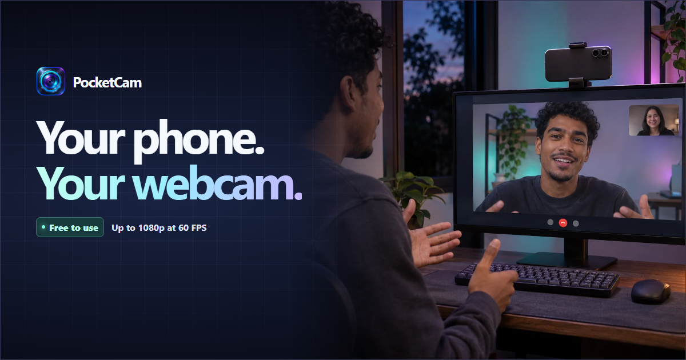

# 

Use your iPhone or Android as a webcam in Discord, Zoom, and other Windows apps. PocketCam is a native Windows 11 app written in Rust. Pair over Wi-Fi or a supported USB connection and capture video at up to **1080p at 60 FPS**.

**[Product website](https://iamo3.github.io/PocketCam/)** · **[Downloads](https://github.com/iaMO3/PocketCam/releases/tag/v2.4.2)** · **[Quick start](#install-and-pair)** · **[Build from source](#build-from-source)**

## Downloads

**PocketCam is free to download and use on Windows, iPhone, and Android.**

| Platform | Download | Requirements |
| --- | --- | --- |
| Windows | [PocketCam 2.4.2 Setup](https://github.com/iaMO3/PocketCam/releases/download/v2.4.2/PocketCam-2.4.2-Setup.exe) | Windows 11 x64. Guided, unsigned installer with optional USB components. |
| Android | [PocketCam 2.4 APK](https://github.com/iaMO3/PocketCam/releases/download/v2.4.2/PocketCam-2.4-Android.apk) | Android 8 or later. Signed APK. |
| iPhone | [PocketCam PiP 2.6 IPA](https://github.com/iaMO3/PocketCam/releases/download/v2.4.2/PocketCam-iPhone-Hybrid-unsigned.ipa) | iOS 18 or later. Personal signing required. Physical iPhone verification of the native floating preview is pending. |

The Windows app also works with the phone’s browser. [Release notes and SHA-256 checksums](https://github.com/iaMO3/PocketCam/releases/tag/v2.4.2)

## Install and pair

1. Close PocketCam if it’s already open and run **PocketCam-2.4.2-Setup.exe**. Approve the Windows prompt, click **Next**, and choose the Android and iPhone USB components you need. Click **Next → Install → Finish**. Setup downloads the selected USB components from Google and Apple.
2. Open PocketCam from the Start menu. Choose a connection under **Connection**, then scan its QR code or type the displayed address into your phone’s browser.
3. On Wi-Fi and USB tethering connections, install the updated certificate from PocketCam on Windows. On iPhone, install the **PocketCam** profile and enable full trust for **PocketCam Camera** in **Settings → General → About → Certificate Trust Settings**. The Home Screen app checks trust before opening the camera. iOS shows **Not Signed** for the locally generated profile.
4. Enter the eight-digit pairing code and tap **Start camera**. Keep the phone page in the foreground.
5. In Discord, go to **User Settings → Voice & Video → Camera** and choose **PocketCam (Windows Virtual Camera)**. Keep the Windows PocketCam window open. Restart Discord if it was open during the upgrade and its camera list needs refreshing.

Choose **Theme** in the upper right to switch between **System**, **Light**, and **Dark**. The Windows title bar follows the app and your choice is saved. The phone screens follow the phone’s appearance.

PocketCam sends video only. Select a microphone in your calling app.

## Video quality and orientation

Choose **Auto**, **Landscape**, or **Portrait** on Windows. Auto follows the phone as you turn it. Enable screen rotation on the phone for the display to follow its physical orientation. Use **Rotate clockwise** to correct a sideways or upside-down picture. The phone preview shows the same crop and rotation sent to Windows.

Use the phone’s **Camera** picker to choose a front or rear camera, or select a specific lens once the phone grants camera permission. The list depends on what the phone makes available to PocketCam.

The default is **1080p at 30 FPS**. Select **60 FPS** for up to **1080p at 60 FPS** on a supported phone and connection. The preview shows incoming FPS. The Windows virtual camera paces samples to the calling app’s negotiated frame rate and repeats the latest frame during brief phone or connection dips. A calling app that requests a landscape frame will see a portrait feed centered with black bars.

## Phone companions

### Install PocketCam on the iPhone Home Screen

1. Scan the Windows QR code in Safari and tap **Download PocketCam profile**. Match the certificate name shown on the PC.
2. Install the profile in **Settings → Profile Downloaded**. The profile adds the PocketCam Home Screen icon and your PC’s certificate.
3. Enable full trust for **PocketCam Camera** in **Settings → General → About → Certificate Trust Settings**.
4. Open the PocketCam icon and enter the pairing code from Windows. If an earlier session is still paired, click **Disconnect** on Windows first.

You can also open the secure camera page in Safari and use **Share → Add to Home Screen**. Enable **Open as Web App** if the option appears.

The Home Screen app opens at the saved PC address. If that address changes, scan the current QR code and add PocketCam again.

### Keep the camera visible while switching apps

- **Android**. Update the APK and the Windows app. Start the camera, then tap **Floating preview** to open Android’s Picture-in-picture window. You can switch apps with the preview visible. Closing the preview or locking the device pauses the camera.
- **iPhone**. Use the hybrid **PocketCam PiP** companion on iOS 18 or later. Enter the PC address and pair in the companion, then tap **Start camera → Floating preview**. The companion uses the familiar PocketCam camera interface with native AVFoundation capture and AVKit Picture-in-Picture on devices that report camera multitasking support. If iOS interrupts capture, return to the app. Camera multitasking in the Safari and profile-installed versions depends on WebKit.

- **Android 8 or later**. Open **PocketCam-Android.apk** on the phone and approve installation for the app that opened the file. The APK is signed with a local release key.
- **iPhone, iOS 18 or later**. **PocketCam-iPhone-Hybrid-unsigned.ipa** contains the arm64 companion and requires personal signing. In AltStore Classic, open **My Apps**, tap **+**, and choose the IPA. On Windows, keep PocketCam open and click **Disconnect** if the browser version is still paired, then enter the new pairing code in **PocketCam PiP**.
- Open PocketCam on the phone and enter the PC address shown under the Windows QR code. On a first Wi-Fi or USB tether connection, tap **First-time certificate setup**, complete the certificate instructions in the system browser, then return to the app and tap **Open camera**. Enter the PC pairing code and allow camera access. On Android ADB, click **Connect Android USB** on Windows and choose **Use Android USB (ADB)** in the phone app.
- Use **Connection** in the phone companion to change PCs. Scanning the desktop QR code with the phone's system camera still opens the browser workflow.

## USB connections

- **iPhone USB**. Select **iPhone USB** in Setup to install Apple Mobile Device Support if needed. Plug the iPhone in with a data cable, tap **Trust** if prompted, and turn on **Settings → Personal Hotspot → Allow Others to Join**. Select **iPhone USB** in PocketCam and open **Network adapter** to choose the Apple tether adapter if needed. Personal Hotspot availability depends on your carrier.
- **Android USB tethering**. Plug the phone in, enable **USB tethering** under **Hotspot & tethering**, and select **Android USB tethering** in PocketCam. Choose the new USB network adapter if needed and scan the code in Chrome.
- **Android USB (ADB)**. Select **Android USB** in Setup to install Platform-Tools and the Google USB driver. Other Android models may require their manufacturer’s USB driver. Enable **USB debugging** on the phone, connect the USB cable, approve the phone’s USB debugging prompt, and click **Connect Android USB** in PocketCam. On the phone, choose **Use Android USB (ADB)** or open **http://127.0.0.1:47746** in Chrome. ADB uses the USB cable directly and skips the certificate step.

If a USB tether link won’t open, check that Windows lists a tether adapter with an IPv4 address. Choose it in PocketCam and make sure its network profile is **Private**. On a trusted home network, the equivalent Wi-Fi or Ethernet adapter also needs the **Private** profile. The installer opens the PocketCam setup and camera ports to the local subnet on private networks.

You can remove old certificates from the phone after changing connections. To uninstall the PC app, close its window and uninstall PocketCam from **Settings → Apps → Installed apps**.

## Build from source

Run **cargo build --workspace --release --locked** with an x64 Windows Rust toolchain, a C compiler, and the Windows resource compiler on PATH (**windres** for GNU or **rc.exe** for MSVC). Copy **pocketcam.exe** and **pocketcam_camera.dll** from **target/release** next to the installer scripts in **scripts**. The phone pages are compiled into the app.

The receiver accepts frames over a single WebSocket connection and drops queued frames when decoding falls behind. It sends NV12 through an access-controlled Windows pipe to the Media Foundation camera. The app stores pairing settings locally and keeps video frames in memory.

Build the single Windows installer with **scripts/Build-Setup.ps1** and NSIS 3. Build the Android APK with PowerShell 7 and **scripts/Build-Android.ps1** using a JDK 17 directory, the Android 35 platform jar, and Android Build Tools 35.0.0. Keep the signing directory supplied to the build for future Android updates. To rebuild the unsigned iPhone IPA on macOS, run **sh scripts/Build-iOS.sh** with the iPhoneOS 18 SDK or newer.

The product website is in [docs](docs/). See [third-party notices](THIRD-PARTY-NOTICES.txt) for bundled components.
