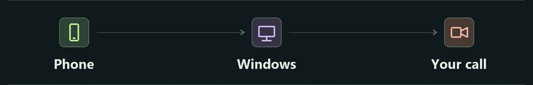
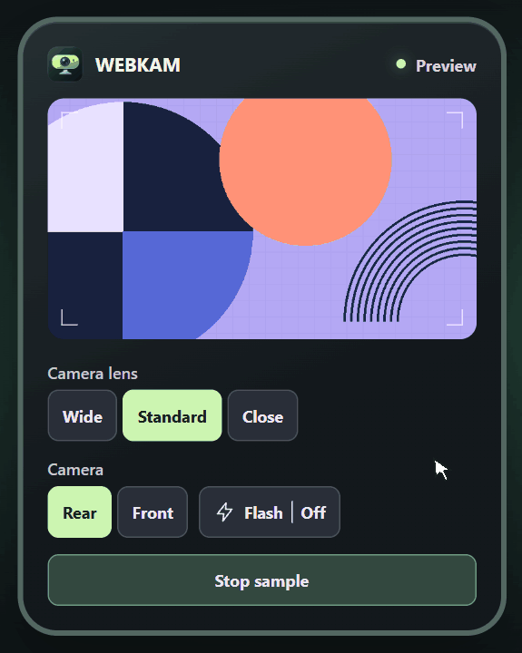
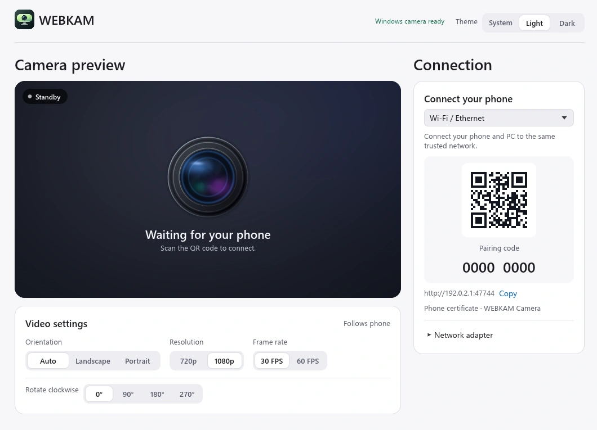

[](https://iamo3.github.io/WEBKAM/)

# WEBKAM

Use your iPhone or Android as a webcam over Wi-Fi or supported USB connections. WEBKAM is free and the desktop receiver runs natively in Rust. Windows 11 supports up to **1080p at 60 FPS**. The macOS preview release supports up to **1080p at 30 FPS** through the bundled VirtualCamera4Mac extension.

<p align="center">
  <a href="https://github.com/iaMO3/WEBKAM/releases/tag/v1.0.3"></a>
  <a href="https://iamo3.github.io/WEBKAM/#preview"></a>
  <a href="#install-and-pair"></a>
  <a href="#build-from-source"></a>
</p>

<picture>
  <source media="(prefers-reduced-motion: reduce)" srcset="docs/media/connection-route.png">
  
</picture>

## Inside Camera Studio

**New in v1.0.3** · The iPhone camera in Safari and the Home Screen app now retries interrupted connections and keeps sending frames when Safari pauses preview callbacks. Update the desktop receiver, then reopen the phone viewfinder. Your existing profile still works.

Use **Wide**, **Standard**, or **Close** in the phone viewfinder to change the framing sent to your call. Tap **Rear** for a supported camera’s flash, or **Front** for screen light. The camera lens menu still lets you pick an individual lens.

<table>
  <tr><th align="left">Windows receiver</th><th align="left">iPhone companion</th></tr>
  <tr>
    <td width="72%" align="center"><a href="docs/media/desktop.webp?raw=true&amp;v=lighting-1"></a></td>
    <td width="28%" align="center"><a href="docs/media/phone.webp?raw=true&amp;v=controls-2"></a></td>
  </tr>
  <tr><td><strong>Rear camera.</strong> Flash is on in Video settings, beside Resolution.</td><td><strong>Front camera.</strong> Screen light is on. The white display lights your face.</td></tr>
</table>

<p align="center">
  <a href="https://iamo3.github.io/WEBKAM/#panel-phone">
    <picture>
      <source media="(prefers-reduced-motion: reduce)" srcset="docs/media/camera-light-demo-still.png">
      
    </picture>
  </a>
  <br>
  <a href="https://iamo3.github.io/WEBKAM/#panel-phone">Try the lighting controls in the interactive demo</a>
</p>

The desktop receiver, mobile companions and iPhone Home Screen app share light and dark themes. The screenshots use example pairing details and a sample camera feed. Select a screenshot for the full image, or [explore the pairing screen and framing demo](https://iamo3.github.io/WEBKAM/#panel-pairing).

## Install and pair

1. **Open the Windows receiver.** Run the Windows x64 installer. Select the USB components you need during setup and choose your connection in WEBKAM.
2. **Connect the phone.** Scan the QR code with your phone’s camera for browser setup, or type the PC address into the companion. On iPhone, open the setup link in Safari to download the profile. Follow the certificate setup when prompted, enter the eight-digit code displayed on your PC, and tap **Start camera**.
3. **Choose WEBKAM in your call.** In Discord, open **User Settings → Voice & Video → Camera**. Select **WEBKAM (Windows Virtual Camera)** and choose a microphone separately. Keep the receiver open during the call.

<details>
<summary>See the Windows pairing screen and iPhone certificate steps</summary>

[](docs/media/pairing.webp)

[See the iPhone profile setup screen](docs/media/profile.webp). Use the QR code displayed on your own PC. On iPhone, **Safari is required to download the WEBKAM profile**. Open the setup link in Safari, download and install the profile, and enable full trust for **the certificate shown in the Windows receiver** under **Settings → General → About → Certificate Trust Settings**. The profile adds the web app to your Home Screen. iOS shows **Not Signed** for the locally generated profile.

If another phone session is paired, click **Disconnect** in the Windows app to get a new code. Restart Discord if it was open during installation and its camera list needs refreshing.

</details>

### Install on a Mac

1. Download the [universal DMG](https://github.com/iaMO3/WEBKAM/releases/download/v1.0.3/WEBKAM-1.0.3-macOS-universal.dmg) for macOS 13 Ventura or later. It covers Intel and Apple silicon MacBooks and desktop Macs.
2. Open the DMG and drag **WEBKAM** to **Applications**. Open the included **VirtualCamera4Mac** disk image and copy that app to **Applications** too. Open VirtualCamera4Mac, select **Install / Activate**, and approve the camera extension in System Settings.
3. Open WEBKAM, connect your phone to the same Wi-Fi network and scan the QR code. Open the link in Safari on iPhone to download the profile. Follow the phone setup page, then enter the eight-digit pairing code and tap **Start camera**.
4. Select **VirtualCamera4Mac** as the camera in your calling app. Keep the WEBKAM receiver open during the call.

The macOS receiver is an early build and uses an ad-hoc signature. See the [macOS release notes](https://github.com/iaMO3/WEBKAM/releases/tag/v1.0.3) for installation details and checksums.

## Downloads

All WEBKAM downloads are free. For browser capture, scan the desktop QR code in Safari or Chrome and keep the phone page open while streaming.

| Platform | Download | Requirements |
| --- | --- | --- |
| Windows | [WEBKAM 1.0.3 Setup](https://github.com/iaMO3/WEBKAM/releases/download/v1.0.3/WEBKAM-1.0.3-Setup.exe) | Windows 11 x64. Guided, unsigned installer with optional USB components. |
| macOS | [WEBKAM 1.0.3 Universal DMG](https://github.com/iaMO3/WEBKAM/releases/download/v1.0.3/WEBKAM-1.0.3-macOS-universal.dmg) | macOS 13 or later. Intel and Apple silicon. Preview release with bundled camera extension. |
| Android | [WEBKAM 1.0.3 APK](https://github.com/iaMO3/WEBKAM/releases/download/v1.0.3/WEBKAM-1.0.3-Android.apk) | Android 8 or later. Signed APK. |
| iPhone | [WEBKAM 1.0.3 IPA](https://github.com/iaMO3/WEBKAM/releases/download/v1.0.3/WEBKAM-1.0.3-iPhone-unsigned.ipa) | iOS 18 or later. Personal signing required. Physical iPhone verification of the native floating preview is pending. |

[Release notes and SHA-256 checksums](https://github.com/iaMO3/WEBKAM/releases/tag/v1.0.3)

## Video quality and orientation

| Control | Where | What it does |
| --- | --- | --- |
| Flash / Screen light | Desktop or phone | Use the lightning bolt next to Resolution to toggle a supported rear torch. With a front camera, it switches the phone screen to white for fill light. |
| Camera lens | Phone | Select a front or rear camera, or a specific lens exposed by the phone after camera permission. |
| Resolution and frame rate | Windows | Choose 720p or 1080p at 30 or 60 FPS. The default is 1080p at 30 FPS. Actual FPS depends on the phone, connection, and calling app. |
| Orientation | Windows | **Auto** follows the phone. **Landscape** or **Portrait** locks the output shape. |
| Rotate clockwise | Windows | Correct a sideways or upside-down picture in 90° steps. |
| Theme | Windows | Choose **System**, **Light**, or **Dark**. The title bar follows your choice. The phone interface follows its system appearance. |

The Windows preview reports incoming FPS. The virtual camera paces output to the calling app’s negotiated rate and repeats the latest frame during brief dips. A calling app requesting landscape receives a portrait feed centered with black bars.

## Phone companions

<details>
<summary>Home Screen installation, iPhone signing, and floating preview</summary>

### Install WEBKAM on the iPhone Home Screen

1. Scan the QR code shown in WEBKAM on your computer. **Open the setup link in Safari** on your iPhone. Safari is required to download the profile. Match the certificate name shown on your computer, tap **Download WEBKAM profile**, then tap **Allow**.
2. Install the profile in **Settings → Profile Downloaded**. The profile adds the WEBKAM Home Screen icon and your PC’s certificate.
3. Enable full trust for **the certificate shown in the Windows receiver** in **Settings → General → About → Certificate Trust Settings**.
4. Open the WEBKAM icon and enter the pairing code from Windows. If an earlier session is still paired, click **Disconnect** on Windows first.

You can also open the secure camera page in Safari and use **Share → Add to Home Screen**. Enable **Open as Web App** if the option appears.

The Home Screen app opens at the saved PC address. If that address changes, scan the current QR code and add WEBKAM again.

### Keep the camera visible while switching apps

- **Android**. Update the APK and the Windows app. Start the camera, then tap **Floating preview** to open Android’s Picture-in-picture window. You can switch apps with the preview visible. Closing the preview or locking the device pauses the camera.
- **iPhone**. Use the hybrid **WEBKAM PiP** companion on iOS 18 or later. Enter the PC address and pair in the companion, then tap **Start camera → Floating preview**. The companion uses the familiar WEBKAM camera interface with native AVFoundation capture and AVKit Picture-in-Picture on devices that report camera multitasking support. If iOS interrupts capture, return to the app. Camera multitasking in the Safari and profile-installed versions depends on WebKit.

- **Android 8 or later**. Open **WEBKAM-1.0.3-Android.apk** on the phone and approve installation for the app that opened the file. The APK is signed with a local release key.
- **iPhone, iOS 18 or later**. **WEBKAM-1.0.3-iPhone-unsigned.ipa** contains the arm64 companion and requires personal signing. In AltStore Classic, open **My Apps**, tap **+**, and choose the IPA. On Windows, keep WEBKAM open and click **Disconnect** if the browser version is still paired, then enter the new pairing code in **WEBKAM**.
- Open WEBKAM on the phone and enter the PC address shown under the Windows QR code. On a first Wi-Fi or USB tether connection, tap **First-time certificate setup**, complete the certificate instructions in **Safari on iPhone** or **Chrome on Android**, then return to the app and tap **Open camera**. Enter the PC pairing code and allow camera access. On Android ADB, click **Connect Android USB** on Windows and choose **Use Android USB (ADB)** in the phone app.
- Use **Connection** in the phone companion to change PCs. Scanning the desktop QR code with the phone's system camera still opens the browser workflow.

</details>

## USB connections

| Phone | Connection in WEBKAM | Phone setting |
| --- | --- | --- |
| iPhone | iPhone USB | Trust the PC and enable Personal Hotspot over a data cable. |
| Android | Android USB tethering | Enable USB tethering on the phone. |
| Android | Android USB (ADB) | Enable USB debugging and approve the PC. |

<details>
<summary>USB drivers, network adapters, and troubleshooting</summary>

- **iPhone USB**. Select **iPhone USB** in Setup to install Apple Mobile Device Support if needed. Plug the iPhone in with a data cable, tap **Trust** if prompted, and turn on **Settings → Personal Hotspot → Allow Others to Join**. Select **iPhone USB** in WEBKAM and open **Network adapter** to choose the Apple tether adapter if needed. Personal Hotspot availability depends on your carrier.
- **Android USB tethering**. Plug the phone in, enable **USB tethering** under **Hotspot & tethering**, and select **Android USB tethering** in WEBKAM. Choose the new USB network adapter if needed and scan the code in Chrome.
- **Android USB (ADB)**. Select **Android USB** in Setup to install Platform-Tools and the Google USB driver. Other Android models may require their manufacturer’s USB driver. Enable **USB debugging** on the phone, connect the USB cable, approve the phone’s USB debugging prompt, and click **Connect Android USB** in WEBKAM. On the phone, choose **Use Android USB (ADB)** or open **http://127.0.0.1:47746** in Chrome. ADB uses the USB cable directly and skips the certificate step.

If a USB tether link won’t open, check that Windows lists a tether adapter with an IPv4 address. Choose it in WEBKAM and make sure its network profile is **Private**. On a trusted home network, the equivalent Wi-Fi or Ethernet adapter also needs the **Private** profile. The installer opens the WEBKAM setup and camera ports to the local subnet on private networks.

You can remove old certificates from the phone after changing connections. To uninstall the PC app, close its window and uninstall WEBKAM from **Settings → Apps → Installed apps**.

</details>

## Build from source

Build with an x64 Windows Rust toolchain, a C compiler, and a Windows resource compiler on PATH (`windres` for GNU or `rc.exe` for MSVC).

```sh
cargo build --workspace --release --locked
```

The build places `pocketcam.exe` and `pocketcam_camera.dll` in `target/release`. The phone pages are compiled into the app.

The receiver accepts frames over a single WebSocket connection and drops queued frames when decoding falls behind. It sends NV12 through an access-controlled Windows pipe to the Media Foundation camera. The app stores pairing settings locally and keeps video frames in memory.

Build the single Windows installer with **scripts/Build-Setup.ps1** and NSIS 3. Build the Android APK with PowerShell 7 and **scripts/Build-Android.ps1** using a JDK 17 directory, the Android 35 platform jar, and Android Build Tools 35.0.0. Keep the signing directory supplied to the build for future Android updates. To rebuild the unsigned iPhone IPA on macOS, run **sh scripts/Build-iOS.sh** with the iPhoneOS 18 SDK or newer.

For the macOS DMG, install the Xcode command line tools and run:

```sh
rustup target add aarch64-apple-darwin x86_64-apple-darwin
bash scripts/Build-macOS.sh
```

The build adds the original [VirtualCamera4Mac distribution](https://github.com/m96-chan/VirtualCamera4Mac/tree/v0.0.7) for the macOS virtual camera. The extension requires one-time approval in System Settings. The DMG supports Wi-Fi or Ethernet, iPhone USB with Personal Hotspot, and Android USB through ADB with Android Platform-Tools installed.

The product website is in [docs](docs/). See [third-party notices](THIRD-PARTY-NOTICES.txt) for bundled components.
